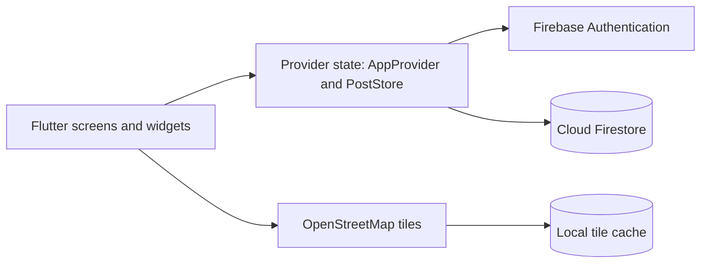
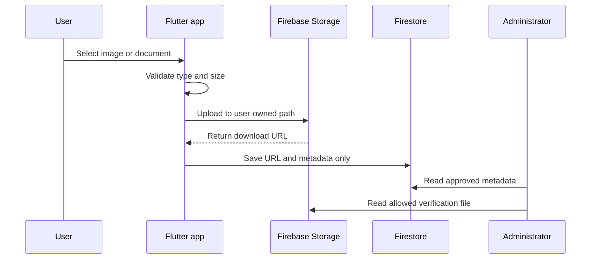

# RecyConnect

RecyConnect is a Flutter mobile and web application that connects households,
scrap collectors, junk shops, and administrators for community recycling.
Users can publish recyclable-material pickup requests, receive offers, agree on
a provider, communicate, view locations, and track the collection lifecycle.

## Project status

The application is connected to the Firebase project configured in
`lib/firebase_options.dart`:

```text
Project ID: recyconnect-mobile-app
```

Implemented backend services:

- Firebase Authentication with email/password login.
- Email verification and password reset.
- Optional device biometric verification after Firebase login for approved users.
- Cloud Firestore persistence for accounts, posts, offers, messages,
  notifications, favorites, and reports.
- Firestore security rules for authenticated and role-based access.
- Local offline cache for OpenStreetMap tiles after an area has been viewed
  online.
- Responsive Flutter layouts for mobile and web-sized screens.
- RecyConnect launcher branding for Android, iOS, and web/PWA installs using
  `web/recycon_icon.jpg`.

Important limitation: uploaded profile photos, identity documents, business
permits, and recyclable-item photos are currently held in memory only. They are
not uploaded to Firebase Storage and will be lost when the app session ends or
the application is restarted.

## Main features

### Household / resident

- Register with contact information, account type, valid ID details, and
  required document selections.
- Verify the email address before signing in.
- Wait for administrator approval before using protected features.
- Create recyclable-material pickup posts.
- Select material, quantity, unit, address, schedule, notes, and optional
  high-value or price-request flags.
- Select a map location/pin and see the approximate location protection used
  before a provider accepts an offer.
- Receive, compare, accept, or decline collector/junk-shop offers.
- Message the selected provider.
- View notifications, collection history, ratings, reports, and regular
  contacts (Suki).
- Edit profile information and log out securely.

### Collector / junk shop

- Register as a collector or junk-shop owner.
- Junk shops can provide a business permit during registration.
- Browse available recycling requests.
- Filter requests by material, distance, schedule, and other visible details.
- View the map pin or route information when permitted.
- Send an offer with amount, unit, and message.
- View accepted jobs and collection history.
- Contact households through protected in-app messaging.
- Save regular contacts and receive notifications.
- Edit profile information and log out securely.

### Administrator

- Review pending registrations.
- View account information and submitted document previews while the
  registration session is available.
- Approve, reject, suspend, reactivate, or delete accounts.
- Clear temporary account security locks.
- Review reports and ratings.
- View dashboard activity and account statistics.
- Configure visible material categories and cancellation reasons in the app
  state.
- Manage profile information and log out securely.

## User and data flow

```mermaid
flowchart TD
    A[Open RecyConnect] --> B[Firebase initializes]
    B --> C{Login or register}
    C -->|Register| D[Create Firebase Auth account]
    D --> E[Send verification email]
    E --> F[Create users/{uid} profile]
    F --> G[Administrator review]
    C -->|Login| H[Firebase email/password sign-in]
    H --> I[Read users/{uid}]
    I --> J{Verified and approved?}
    J -->|No| K[Show safe status message]
    J -->|Yes| L[Open role dashboard]
    L --> M[Household posts request]
    L --> N[Provider sends offer]
    M --> O[Firestore posts and offers]
    N --> O
    O --> P[Accept offer]
    P --> Q[Protected messages and notifications]
    Q --> R[Collection / sold / cancelled history]
```

## Application architecture



The application starts in `StartupApp`, initializes Firebase, initializes the
offline map cache, loads the saved theme preference, and then opens the login
page. The theme toggle is available in dashboards; the login page remains
visually focused on authentication.

## Database design

The app uses the plural `users` collection. A profile document must use the
Firebase Authentication UID as its document ID:

```text
users/{firebaseAuthUid}
```

Example administrator profile:

```text
fullName: "System Administrator"        string
username: "admin"                       string
email: "admin@example.com"              string
role: "admin"                           string
status: "approved"                      string
idType: "other"                         string
phone: "..."                            string
address: "..."                          string
uid: "Firebase Auth UID"                string
emailVerified: false                     boolean
failedLoginAttempts: 0                   int64
createdAt: server timestamp              timestamp
lastActive: server timestamp             timestamp
```

### Firestore collections

| Collection | Purpose | Main access rule |
| --- | --- | --- |
| `users` | Profiles, roles, status, contact details | User sees own profile; admins manage profiles |
| `posts` | Household recyclable pickup requests | Authenticated users see permitted posts |
| `posts/{postId}/offers` | Collector and junk-shop offers | Household owner, offer owner, or admin |
| `conversations/{id}/messages` | Direct and post-related messages | Message participants or admin |
| `notifications` | User-specific notifications | Recipient or admin actions |
| `favorites` | Suki / regular contacts | Owner or administrator |
| `reports` | User reports and moderation records | Reporter and administrators |

The source of truth for Firestore rules is [firestore.rules](firestore.rules).
The singular `user` collection is not used by the application. If an admin
profile was manually created in `user`, recreate or move it to `users` with the
correct Firebase Auth UID.

## Uploaded images and documents

### Current behavior

The registration page accepts two valid-ID files (front and back) together,
plus a business permit for junk-shop accounts. JPG, JPEG, PNG, PDF, DOC, and
DOCX files are limited to 5 MB each. Household posts and profile editing also allow image selection. The
selected bytes are used by the current running app to display previews, but
they are not persisted in Firestore or Firebase Storage.

This is intentional for the free-plan version because binary files should not
be placed directly inside Firestore documents. Permanent file storage should
use Firebase Storage with download URLs stored in Firestore.

### Firebase Spark plan and device synchronization

The application can use Firebase's no-cost Spark plan for a small number of
users and modest usage. Firebase Authentication and Firestore data remain
available across devices as long as every installed copy uses this same Firebase
project configuration, the user has internet access, and the deployed
Firestore rules allow the operation. Firestore usage is still subject to the
Spark plan's quotas.

The current app does not upload registration documents. The valid-ID front,
valid-ID back, and business-permit bytes are held only in the running app's
memory, so they are not available to an administrator on another device and
are lost when the app is closed. Firebase Storage is the correct permanent
solution for those files, but current Firebase Storage access requires the
Blaze billing plan even when usage stays within its no-cost quota. Do not put
the binary documents directly in Firestore.

### Production upload design

When permanent online uploads are enabled, use paths like:

```text
users/{uid}/profile/{fileName}
users/{uid}/verification/{fileName}
posts/{postId}/photo/{fileName}
```

The secure flow should be:



Do not store passwords, private credentials, or unrestricted public file URLs.
Storage rules must validate authenticated ownership, file size, and content
type. Firebase Storage currently requires the Blaze billing plan for new or
continued Storage access, even though a no-cost usage quota may still apply.

## Security design

- Passwords are handled by Firebase Authentication and are never stored in
  Firestore.
- Registration requires email verification.
- Password reset uses Firebase's reset-email flow.
- A user's role and approval status are controlled by administrator rules.
- Users cannot self-register as administrators.
- Firestore rules deny all unmatched paths by default.
- Profiles are keyed by Firebase UID rather than a user-entered username.
- Messages are restricted to their sender and recipient.
- Notifications are restricted to their recipient.
- Reports are restricted to the reporter and administrators.
- Provider access to exact pickup details is restricted by the collection flow.
- Household identity can be displayed anonymously before offer acceptance.
- Failed-login tracking and temporary lock handling are supported in the app.
- Device biometrics use the operating system prompt and never store fingerprint
  images, biometric templates, or passwords. Users can continue with their
  Firebase password when biometrics are unavailable or not enrolled.
- Logout signs out from Firebase and clears the current app state.
- Firebase local development files and environment overrides are excluded by
  [.gitignore](.gitignore).

Deploy Firestore rules with:

```powershell
firebase deploy --project recyconnect-mobile-app --only firestore:rules
```

Review [FIREBASE_SECURITY.md](FIREBASE_SECURITY.md) before deploying changes.
Security rules must be tested in the Firebase Emulator or Rules Playground
before production deployment.

## Offline map behavior

The map uses OpenStreetMap tiles and a local file cache. A user must open the
needed map area once while online. Previously cached tiles can then be viewed
without an internet connection. New areas, routing requests, and live location
updates still require connectivity.

Offline map caching is not offline Firestore synchronization. Firestore data
can remain temporarily available in the app's local state, but the app should
not claim that every write is durable until it has successfully synchronized.

## Setup and run

Requirements:

- Flutter SDK compatible with the Dart SDK constraint in `pubspec.yaml`.
- Firebase project access.
- Android Studio/Xcode for mobile targets, or a supported browser for web.

Commands:

```powershell
flutter pub get
flutter analyze
flutter run
flutter build apk --release
flutter build web --release
```

The Android release artifact is available as
`build/app/outputs/flutter-apk/RecyConnect.apk` after renaming the standard
Flutter output. The installed Android application display name is configured
as `RecyConnect`.

## Release APK and installation

The current Android release is published on GitHub:

- [RecyConnect v1.0.0 release](https://github.com/dayapkristine-sketch/RecyConnect/releases/tag/v1.0.0)

To install a newer local release on a connected Android phone or emulator:

```powershell
flutter clean
flutter pub get
flutter analyze
flutter test
flutter build apk --release
Copy-Item build/app/outputs/flutter-apk/app-release.apk build/app/outputs/flutter-apk/RecyConnect.apk -Force
adb install -r build/app/outputs/flutter-apk/RecyConnect.apk
```

The phone may ask you to allow installation from the browser or file manager.
Only install APKs downloaded from a trusted project source. The APK connects
to the configured Firebase project when the device has internet access.

### Will the app work on different devices?

Yes, the installed APK can be used on multiple Android devices and those
devices can share the same Firebase Authentication accounts and Firestore
records. This means that approved users, posts, offers, messages, notifications,
favorites, reports, and profile fields can be synchronized between devices.

Before distributing the APK, confirm that the Firebase project is configured,
Email/Password Authentication is enabled, the Firestore database exists,
`firestore.rules` is deployed, and each device can connect to the internet.
Device-specific items are not shared: biometric enrollment, theme preference,
cached map tiles, and the currently selected registration documents remain
local to each device. The current APK is connected to Firebase, but it is not
an automatically published public app; users still need the APK file or a
store-distributed build installed on their devices.

Before sharing a release with testers, verify:

1. A new user can register and receive an email verification message.
2. An administrator can approve the account and the approved user can sign in.
3. Household, collector, junk-shop, and administrator role restrictions work.
4. Posts, offers, messages, notifications, reports, and profile changes appear
   in Firestore after synchronization.
5. Logout clears the session, and biometric verification offers password
   fallback when biometrics are unavailable or cancelled.
6. The app behaves safely with Wi-Fi disabled and then reconnects.

Do not use real passwords, identity documents, or private personal data for a
classroom demonstration. Create test accounts and remove test data afterward.

Firebase setup:

1. Enable Email/Password Authentication.
2. Create the Cloud Firestore database.
3. Deploy `firestore.rules`.
4. Create an administrator in Firebase Authentication.
5. Create the matching document at `users/{adminAuthUid}`.
6. Set `role` to `admin` and `status` to `approved`.
7. Verify the administrator email before signing in.

## Biometric authentication

After a successful Firebase login, approved household, collector, junk-shop,
and administrator users are shown a device biometric prompt. The app uses the
`local_auth` package and requests verification through the operating system;
the app never receives or stores the user's fingerprint or face data.

On Android, the device must have a secure screen lock and at least one enrolled
fingerprint or other supported biometric. If biometrics are unavailable,
unenrolled, cancelled, or temporarily locked, the user can select **Continue
with password login**. Firebase email/password authentication remains the
account-level authentication method and is not replaced by local biometrics.

To test biometric authentication on Android:

1. Enroll a fingerprint in the device's security settings, or configure an
   enrolled biometric in a supported Android emulator.
2. Build and install the release APK with `flutter build apk --release`.
3. Sign in with an approved, email-verified account.
4. Complete the biometric prompt, or choose the password fallback.
5. Sign out and repeat the test with another approved role.

The admin activity log also remains protected by the biometric session check.

## GitHub teamwork

The local repository is initialized on the `main` branch. Create the remote
repository in GitHub, then run:

```powershell
git add .
git commit -m "Initial RecyConnect application"
git remote add origin https://github.com/YOUR-TEAM/YOUR-REPOSITORY.git
git push -u origin main
```

The repository is prepared for team collaboration with:

- [CONTRIBUTING.md](CONTRIBUTING.md) for branch, commit, review, and security
  rules.
- [Pull request template](.github/PULL_REQUEST_TEMPLATE.md) for consistent
  review information.
- [Bug report template](.github/ISSUE_TEMPLATE/bug_report.md) for reproducible
  issues.
- [Flutter validation workflow](.github/workflows/flutter.yml), which runs
  analysis, tests, and a web release build on pushes and pull requests to
  `main`.

After the first push, configure the GitHub repository with `main` as the
default branch, invite the team under **Settings > Collaborators**, and protect
`main` by requiring a pull request, one approval, and a successful validation
workflow before merging.

Daily team workflow:

```powershell
git switch main
git pull origin main
git switch -c feature/short-description
git add .
git commit -m "Describe the change"
git push -u origin feature/short-description
```

Open a pull request from the feature branch into `main`. Review the change,
run `flutter analyze` and relevant tests, then merge the pull request. Do not
commit passwords, Firebase service-account keys, `.env` files, or local build
directories.

## PIT alignment and remaining work

The current application demonstrates a functional Flutter/Firebase client with
authentication, role-based workflows, Firestore CRUD, notifications, reports,
responsive screens, and security rules.

If the PIT specifically requires a distributed-database prototype, the project
still needs a separate demonstrator for horizontal/vertical fragmentation,
replication across nodes or containers, distributed joins, and a two-phase
commit success/rollback scenario. Firebase alone does not demonstrate those
database-node requirements. Document that architecture separately rather than
claiming that the current mobile client satisfies it.
